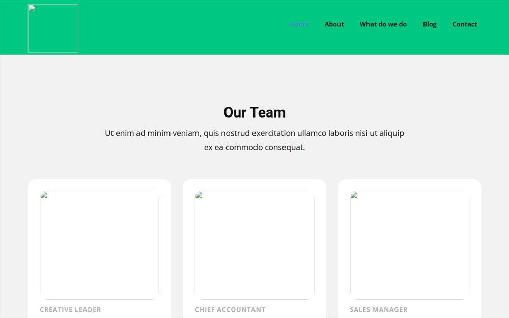

# Blog Share - Multi-page

The multi-page version of the Blog Share template: home, about, contact and a sample post.

**[Open the live site](https://ajeet-iitk.github.io/blog_share/)**

## What it does

A complete static blog skin: a home page with post cards, an about page, a contact page and a sample article. Each page has its own stylesheet, so a section can be restyled without touching the rest.

## Features

- Separate pages for home, about, contact and a post
- Per-page CSS files
- No build step, no backend - pure HTML/CSS with a little jQuery
- Drop-in image assets

## Run locally

Open `index.html`, or use the hosted copy:

<https://ajeet-iitk.github.io/blog_share/>

## Files

| File | Purpose |
| --- | --- |
| `index.html` | Blog home |
| `Home.html`, `About.html`, `Contact.html`, `Page-1.html` | Section pages |
| `*.css` | Per-page styles |

---

Part of [my collection of small projects](https://github.com/Ajeet-iitk).
